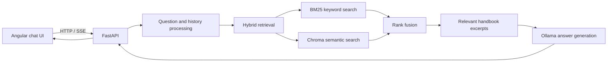

# Employee Policy Assistant

A local document question-answering app for exploring an employee handbook. It combines keyword and semantic retrieval with a locally served language model, then returns an answer with handbook page references.

> **Demo document:** The included handbook is a public template, not a finalized company policy. Bracketed values and optional sections in it may be unfilled or conditional. Treat them as unconfirmed.

## Preview


## Features

- Ask handbook questions in a chat interface built with Angular.
- Retrieve passages with BM25 keyword search and Chroma semantic search, combined with rank fusion.
- Use conversation history to rewrite follow-up questions for retrieval.
- Parse, section, and chunk PDF content while preserving page and section metadata.
- Generate context-grounded answers with a local Ollama model.
- Identify unresolved template values and conditional handbook sections.
- Return source document and page metadata through FastAPI endpoints.

## How it works



## Tech stack

| Area | Tools |
|---|---|
| Frontend | Angular, TypeScript, HTML, CSS |
| API | Python, FastAPI, Pydantic |
| Language model | Ollama, `llama3.2:3b` |
| Retrieval | BM25, semantic search, ensemble rank fusion |
| Embeddings | Sentence Transformers (`all-MiniLM-L6-v2`) |
| Vector store | ChromaDB |
| PDF ingestion | PyPDF, LangChain text splitters |
| Chat transport | REST and Server-Sent Events (SSE) |

## Repository layout

```text
ai-policy-bot/
├── images/
│   └── home.png               # Chat UI preview
├── documents/
│   ├── company_policy.pdf     # Source handbook template
│   └── image.png              # Rank-fusion illustration
├── chroma_db/                 # Generated Chroma index
├── frontend/                  # Angular application
├── src/
│   ├── ingest.py              # PDF parsing and indexing
│   ├── rag.py                 # Retrieval and answer generation
│   └── main.py                # FastAPI app and chat endpoints
├── test_hybrid.py
├── test_retrieval.py
├── test_stream.py
├── requirements.txt
└── README.md
```

## Requirements

- Python 3.12
- Node.js and npm
- [Ollama](https://ollama.com/)
- The `llama3.2:3b` model pulled into Ollama

## Run locally

### 1. Create a Python environment

From the repository root:

```powershell
python -m venv venv
.\venv\Scripts\Activate.ps1
python -m pip install -r requirements.txt
```

### 2. Start the local model

```powershell
ollama pull llama3.2:3b
```

Make sure the Ollama service is running before starting the API.

### 3. Index the handbook

The included PDF is already at `documents/company_policy.pdf`. To create or refresh the Chroma index, run:

```powershell
python -m src.ingest
```

The first run may download the Sentence Transformers embedding model.

### 4. Start the API

In a terminal at the repository root:

```powershell
uvicorn src.main:app --reload
```

- API: <http://localhost:8000>
- Interactive API docs: <http://localhost:8000/docs>

### 5. Start the Angular app

In a second terminal:

```powershell
cd frontend
npm install
npm start
```

Open <http://localhost:4200>.

## API

| Method | Path | Purpose |
|---|---|---|
| `GET` | `/` | API health message |
| `POST` | `/chat` | Return a complete answer and source pages |
| `POST` | `/chat/stream` | Return answer, source, and completion events over SSE |

Example request:

```json
{
  "question": "What does the handbook say about sick leave?",
  "history": []
}
```

The `history` field is optional and contains prior messages with `user` or `assistant` roles.

## Source handbook

The sample PDF is the [Workable Employee Handbook template](https://resources.workable.com/wp-content/uploads/2017/09/Employee-Handbook.pdf). Its placeholder values, alternatives, and conditional sections are not confirmed policies for any particular company.

## Notes and limitations

- Answers depend on retrieval quality and the local language model; check the cited handbook pages for important details.
- The sample handbook contains incomplete and optional template content, so some policy values are intentionally unspecified.
- The demo API does not include authentication or multi-user data isolation.

## Rank fusion illustration

The retriever combines keyword and semantic result rankings to prioritize passages that appear near the top of either result list.


